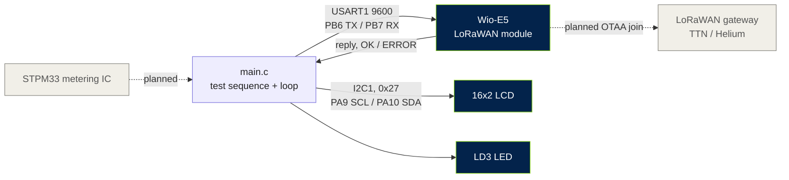

<div align="center">


<a href="#-how-it-works"></a>

<br/>

[](https://www.st.com/en/evaluation-tools/nucleo-l432kc.html)
[](Core/Src/main.c)
[-84CC16)](https://wiki.seeedstudio.com/LoRa-E5_STM32WLE5JC_Module/)
[](https://www.st.com/en/development-tools/stm32cubeide.html)
<br/>
[](#-status-and-next-steps)
[](LICENSE)

</div>

---

##  Project Overview

First step (16 October 2025) of an **industrial smart energy meter with LoRaWAN**: a NUCLEO-L432KC drives a **Seeed Wio-E5** LoRaWAN module over UART with AT commands and prints each reply on a **16x2 I2C LCD**, to confirm the link, read the module's IDs and check its power, band and mode settings. The metering part (ST **STPM33** energy-metering IC) and secure OTAA join are planned in the design documents in this repo, not implemented yet.

It is the LoRaWAN successor to the point-to-point LoRa work in [PowerMET](https://github.com/mukesh-dev-git/PowerMET), [LoRa-STM32](https://github.com/mukesh-dev-git/LoRa-STM32) and [LoRa-ESP32](https://github.com/mukesh-dev-git/LoRa-ESP32), and to the [SM-POC](https://github.com/mukesh-dev-git/SM-POC-Backend) dashboard.

### Key Features

-  **AT driver**: `WioE5_SendCommand` adds CR+LF and sends on USART1 (9600 baud); `WioE5_ReceiveResponse` collects bytes until `OK` / `ERROR` or a timeout.
-  **Start-up test sequence**: `AT`, `AT+VER`, `AT+ID`, `AT+POWER`, `AT+POWER=14`, `AT+DR=SCHEME`, `AT+LW=VER`, `AT+MODE`, `AT+MODE=LWOTAA`, then `AT+JOIN` (expected to fail until keys are set).
-  **Monitor loop**: cycles `AT`, `AT+POWER`, `AT+MODE`, `AT+DR=SCHEME` and toggles the LD3 LED.
-  **LCD**: own HD44780 4-bit driver over a PCF8574 backpack at 0x27; long replies are split across both lines.
-  **Design docs**: meter architecture, STPM33 integration, firmware plan, LoRaWAN security setup, frequency-band and Wio-E5 guides.

##  How It Works



##  Wiring

| From | To (NUCLEO-L432KC) | Notes |
|---|---|---|
| Wio-E5 RX | PB6 (USART1 TX) | 3.3V logic, 9600 baud (Wio-E5 default) |
| Wio-E5 TX | PB7 (USART1 RX) | |
| Wio-E5 VCC / GND | 3.3V / GND | Keep an antenna connected before transmitting |
| LCD backpack SCL | PA9 (I2C1) | |
| LCD backpack SDA | PA10 (I2C1) | |
| LCD backpack VCC / GND | 5V / GND | |
| (USB) | ST-LINK virtual COM, USART2 115200 | Configured, not used by the code |

Clock: MSI 4 MHz (LSE-trimmed) → PLL → 32 MHz.

##  Build and Flash

1. Open the folder in **STM32CubeIDE** (or open `SM-Dev1.ioc` and generate code).
2. Build and flash over the Nucleo's built-in ST-LINK.
3. Watch the LCD: `LCD Init OK`, then each test name followed by the module's reply, then `Test Complete!` and the monitor loop.

### Before a real join

Register the device on The Things Network (or another LoRaWAN server) with the DevEUI from `AT+ID`, then set the keys from your own code or a serial terminal. Use the band your country allows (`IN865` for India); see `FREQUENCY_BAND_GUIDE.md`.

```c
WioE5_SendCommand("AT+DR=IN865");
WioE5_SendCommand("AT+ID=AppEui,\"<your JoinEUI>\"");
WioE5_SendCommand("AT+KEY=APPKEY,\"<your AppKey>\"");
WioE5_SendCommand("AT+JOIN");
```

Never commit a real AppKey; the values in the guides are well-known example keys.

##  Troubleshooting

| Symptom | Check |
|---|---|
| `No Response` | TX/RX crossed (PB6 → module RX), common ground, 9600 baud |
| LCD blank | Contrast pot, 5V supply, address 0x27 (try 0x3F) |
| `+JOIN: Join failed` | Expected until the device is registered and keys / band are set |
| Reply looks cut off | Only the first 32 characters fit on the 2 lines; read the full reply with a USB-serial adapter on the module's TX |

##  Project Structure

```
SM-Dev1/
├── Core/
│   ├── Inc/wio_e5_commands.h        # AT command strings and notes
│   ├── Inc/i2c_lcd.h, Src/i2c_lcd.c # LCD driver
│   └── Src/main.c                   # test sequence, AT send/receive, LCD output
├── Drivers/                         # STM32L4 HAL and CMSIS (generated)
├── SM-Dev1.ioc                      # CubeMX configuration (NUCLEO-L432KC)
├── ENERGY_METER_ARCHITECTURE.md     # overall meter design
├── STPM33_ENERGY_METER_ARCHITECTURE.md
├── FIRMWARE_DEVELOPMENT_PLAN.md     # modules to build before the STPM33 arrives
├── SECURE_LORAWAN_SETUP.md          # OTAA registration and keys
├── FREQUENCY_BAND_GUIDE.md
└── WIO_E5_SETUP_GUIDE.md
```

##  Status and Next Steps

Single-commit bring-up, paused in October 2025.

| Area | State |
|---|---|
| UART link to Wio-E5, AT replies on LCD | Working |
| LoRaWAN join and uplinks | Not done: no keys or band set, `AT+JOIN` is only a test |
| STPM33 energy measurement | Planned in the docs; hardware was not yet available |
| Receive path | Polled one byte at a time; no interrupt or DMA |

Next steps from `FIRMWARE_DEVELOPMENT_PLAN.md`: a non-blocking LoRaWAN module (join, uplink, retry), payload encoding, the STPM33 SPI driver, and power management.

##  License

My code (`i2c_lcd.c`, `i2c_lcd.h`, `wio_e5_commands.h` and the `USER CODE` sections of `main.c`) and the documents are MIT, see [LICENSE](LICENSE). Files generated by STM32CubeMX and everything under `Drivers/` remain under STMicroelectronics' and Arm's licenses stated in those files.

<div align="center">


</div>
